## overview {#overview}

My current research explores landform evolution and geomorphological processes using Geospatial Information System (GIS), Global Navigation Satellite System (GNSS/GPS) surveying, airborne and terrestrial laser scanning (ALS and TLS), structure-from-motion multi-view stereo photogrammetry (SfM-MVS), and rock property measurements. Major focus of my research is on, but not limited to, knickzones (namely knickpoints and waterfalls) in bedrock rivers. Rates of landform changes at knickzones are investigated using both field- and GIS-based data for study fields worldwide (Japan, Taiwan, North America and European Alps). Spatial distribution of knickzones is also examined using GIS techniques for analyzing Digital Elevation Models (DEM). My research interest also involves geoarchaeological examination of palaeoenvironments, with particular emphasis on impacts of landforms on human activities and human-induced changes in landforms. The studies include the use of GIS, satellite remote sensing, laser measurement, GNSS mapping and other field data collection techniques for study areas of archaeological sites in and around Anatolia and the Middle East (e.g., Turkey, Syria, Oman and Azerbaijan). These techniques related GIS and geomorphology are also being applied to modern urbanized areas.

地球科学，とくに地形学や自然地理学，地考古学に関する研究課題に空間情報科学的視点から取り組んでいる。たとえば遷急区間や蛇行度に着目した岩盤河川の地形解析から，日本をはじめ台湾，北アメリカ，ヨーロッパアルプスなどの調査地において，地形発達過程や地形変化プロセスの研究を行っている。手法としてはDEMによる地形解析，GNSS調査，航空・地上レーザ測量，SfM写真測量，岩盤強度測定などを用いる。また主にアナトリア・中東地域において，地考古学における空間情報科学の適用から古環境変動や人類と自然の相互作用の解明を目指しており，こうした手法の現代都市への適用にも関心をもっている。

## topics {#topics}

### bedrock rivers {#bedrock-rivers}

#### 岩盤河川地形

#### 河床遷急区間の分布

河床遷急区間（河川縦断面形において部分的に急勾配で、侵食が活発な区間：峡谷や滝など）は、岩盤河川地形において重要な地形要素であるが、その広範囲にわたる分布についてはこれまでほとんど調べらてこなかった。本研究では、日本列島の山地岩盤河川における河床遷急区間の分布を、DEM（デジタル標高モデル）に基づくGISを用いた河床勾配計測により明らかにした。遷急区間は河川の上流域、河床勾配が急になっている部分、また主要河川どうしの合流点付近により多く存在し、これらは遷急区間が河川の水理的な作用により形成されていることを示唆する。さらに、遷急区間の出現頻度に典型的な値があることも明らかになった。一方、地質の遷急区間形成に対する影響は限られていることが示唆された。

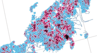

density distribution of knickzones遷急区間マップ「日本列島滝だらけ」

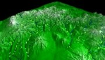

distribution of knickzones in Kanto region, Japan

##### References

- Hayakawa, Y.S., Oguchi, T. (2014) Spatial correspondence of knickzones and stream confluences along bedrock rivers in Japan: Implications for hydraulic formation of knickzones. Geografiska Annaler: Series A, Physical Geography, 96 (1), 9–19. [https://doi.org/10.1111/geoa.12024](https://doi.org/10.1111/geoa.12024)
- Hayakawa, Y.S., Oguchi, T. (2009) GIS analysis of fluvial knickzone distribution in Japanese mountain watersheds. Geomorphology, 111, 27–37. [https://doi.org/10.1016/j.geomorph.2007.11.016](https://doi.org/10.1016/j.geomorph.2007.11.016)
- Hayakawa, Y.S., Oguchi, T. (2006) DEM-based identification of fluvial knickzones and its application to Japanese mountain rivers. Geomorphology, 78, 90–106. [https://doi.org/10.1016/j.geomorph.2006.01.018](https://doi.org/10.1016/j.geomorph.2006.01.018)

#### 滝の後退メカニズム

岩盤河川における滝や遷急点の後退は河川地形の発達において重要なプロセスの一つである。しかし、その詳細なメカニズムについては実は不明な部分も多い。典型的によく知られているのは、滝のキャップロック構造とその侵食モデルである。これは、「固い岩盤が滝を形作っている」という前提で、固い層の下位にある比較的軟らかい層が先に削られることにより、滝の後退が生じるといった考えである。ところが、その力学的な妥当性について、このキャップロックモデルのもととなったナイアガラフォールズで検証したところ、１）岩盤強度は新鮮な場合それほど差がないこと、２）滝面下部の実際の凹みに対して崖面は頑丈であり、キャップロックモデルであらわされるような突発的で大規模な崩落は生じにくいこと、すなわち、岩盤の風化と水流による侵食により、滝面の岩石が少しずつ剥離されていくことによりこの滝の後退が進行することがわかった。これは、滝の侵食メカニズムに関して新たな知見をもたらしたものである。

[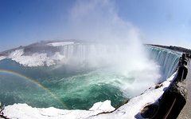](https://www.flickr.com/photos/tagiru/15795228154)

receding niagara / 後退するナイアガラ滝

##### References

- Hayakawa, Y.S., Matsukura, Y. (2010) Stability analysis of waterfall cliff face at Niagara Falls: An implication to erosional mechanism of waterfall. Engineering Geology, 116 (1–2), 178–183. [https://doi.org/10.1016/j.enggeo.2010.08.004](https://doi.org/10.1016/j.enggeo.2010.08.004)

#### 滝の後退速度

Goro Falls in southern Aso caldera foothill / 阿蘇外輪山南麓，五老ヶ滝

滝の後退速度とその規定要因について、千葉県房総半島における滝について調査した（Hayakawa and Matsukura, 2003）。房総半島は、日本の中でも大きな隆起速度と侵食速度が観察される地域であり、滝の侵食速度も年間数cmから数10 cmと大きい。一方、滝の後退速度に影響する主要因は河川の侵食力と岩盤の抵抗力と考えられ、それぞれを表す計測可能なパラメータを現地または図上計測により取得し、これらから次元解析に基づいて導いた無次元パラメータと滝の後退速度との間には高い相関関係がみられた。これにより、滝の後退速度を推定する経験式が得られた。続いて、この式の妥当性や限界を、その他の多くの地域において検証を進めた。調査した滝は、華厳滝や称名滝といった日本国内の著名・無名な滝から、台湾、北米（コロラド、ナイアガラ）、スイスアルプスといった様々な地域にわたる。

[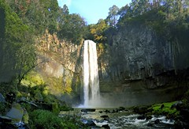](https://www.flickr.com/photos/tagiru/8327157045)

Goro Falls / 阿蘇・五老ヶ滝

##### References

- 早川裕弌・松多信尚・前門 晃・松倉公憲 (2013) 集集地震により生じた台湾中西部における滝の地震後10年間の後退速度とその変化. 地形, 34 (1), 21–36. [ [CiNii](https://cir.nii.ac.jp/crid/1520009408766133376) ]
- Hayakawa, Y.S. (2011) Postglacial recession rates of waterfalls in alpine glacial valleys. Transactions, Japanese Geomorphological Union, 32 (2), 179-184. [[CiNii](https://cir.nii.ac.jp/crid/1520009407821640832?lang=en)]
- Hayakawa, Y.S., Matsukura, Y. (2009) Factors influencing the recession rate of Niagara Falls since the 19th century. Geomorphology, 110, 212–216. [https://doi.org/10.1016/j.geomorph.2009.04.011](https://doi.org/10.1016/j.geomorph.2009.04.011)
- Hayakawa, Y.S., Matsuta, N., Matsukura, Y. (2009) Rapid recession of fault-scarp waterfalls: Six-year changes following 921 Chi-Chi Earthquake in Taiwan. Transactions, Japanese Geomorphological Union, 30 (1), 1–13. [[CiNii](https://cir.nii.ac.jp/crid/1520290883089132416?lang=en)]
- Hayakawa, Y.S., Yokoyama, S., Matsukura, Y. (2008) Erosion rates of waterfalls in post-volcanic fluvial systems around Aso volcano, southwestern Japan. Earth Surface Processes and Landforms, 33 (5), 801–812. [https://doi.org/10.1002/esp.1615](https://doi.org/10.1002/esp.1615)
- Hayakawa, Y.S., Obanawa, H., Matsukura, Y. (2008) Post-volcanic erosion rates of Shomyo Falls in Tateyama, central Japan. Geografiska Annaler, 90A (1), 65–74. [https://doi.org/10.1111/j.1468-0459.2008.00334.x](https://doi.org/10.1111/j.1468-0459.2008.00334.x)
- 早川裕一, 横山勝三, 松倉公憲 (2005) 阿蘇火山・立野峡谷付近における滝の後退速度. 地形, 26 (4), 439-449. [[CiNii](https://cir.nii.ac.jp/crid/1520853832481762304?lang=en)]
- Hayakawa, Y.S., Wohl, E.E. (2005) Recession rate of Poudre Falls in Rocky Mountain Front Range, Colorado, USA. Geographical Review of Japan, 78 (12), 853–858. [https://doi.org/10.4157/grj.78.853](https://doi.org/10.4157/grj.78.853)
- Hayakawa, Y. (2005) Reexamination of a predictive equation of waterfall recession rates in Boso Peninsula, Chiba Prefecture, Japan. Geographical Review of Japan, 78 (5), 265–275. [https://doi.org/10.4157/grj.78.265](https://doi.org/10.4157/grj.78.265)
- 早川裕一, 松倉公憲 (2003) 日光，華厳滝の後退速度. 地学雑誌, 112 (4), 521–530. [https://doi.org/10.5026/jgeography.112.4_521](https://doi.org/10.5026/jgeography.112.4_521)
- Hayakawa, Y., Matsukura, Y. (2003) Recession rates of waterfalls in Boso Peninsula, Japan, and a predictive equation. Earth Surface Processes and Landforms, 28 (6), 675–684. [https://doi.org/10.1002/esp.519](https://doi.org/10.1002/esp.519)

#### 岩盤河川の蛇行度 channel sinuosity

「地形」は我々の足元をなす地球表層の重要な要素であり、地殻変動や地質、気候などさまざまな条件によって侵食・堆積を繰り返しつつ変化する。岩盤河川は山地の侵食地形を代表する一つであるが、本研究ではこの岩盤河川地形の平面形に対する気候、とくに台風による豪雨頻度の影響を空間定量的に解明した。

対象とした岩盤河川は日本列島および台湾、フィリピン等を含む、西太平洋地域の低緯度から中緯度まで広範囲にわたる。まずはスペースシャトルによりレーダー計測された全球数値地形モデルに基づき、地理情報システム（GIS）を用いて穿入蛇行する山地岩盤河川の蛇行度の定量化を行った。次に日本列島において詳細な地質区分と、日雨量50-mm以上の豪雨頻度との対応をみると、強度の低い岩石であるほど河川の穿入蛇行は大きくなるものの、どの地質区分においても、豪雨頻度が高くなるほど蛇行度も大きくなる傾向がみられた。さらに地理空間的に平均した蛇行度は、南北方向に比較すると亜熱帯地方で最大値を示し、赤道および中緯度に向けてそれぞれ減少することがわかった。これは、台風の経路データからもたらされる台風襲来頻度と一致する傾向であり、地形と気候との相関が空間定量的に示されたといえる。

##### References

- Stark, C.P., Barbour, J.R., Hayakawa, Y.S., Hattanji, T., Hovius, N., Chen, H., Lin, C-W., Horng M-J., Xu K-Q., Fukahata, Y. (2010) The climatic signature of incised river meanders. Science, 327 (5972), 1497–1501. [https://doi.org/10.1126/science.1184406](https://doi.org/10.1126/science.1184406)

[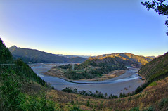](https://www.flickr.com/photos/tagiru/5443973847)

incised meander - 穿入蛇行する大井川

### high-definition topography {#high-definition-topography}

#### terrestrial laser scanning / 地上レーザ測量

地上レーザ測量（TLS）は、地球科学分野で近年広まりつつある、高解像度地形情報取得方法の一つである。中距離型、短距離型の2つのレーザスキャナを用いて、日本国内をはじめ世界各地で現地調査を行い、得られる高解像度地形情報の解析や利活用について検討を行っている。

[HD-Topography Project / 地形鮮明化プロジェクト](http://topography.csis.u-tokyo.ac.jp/)

- Hayakawa, Y.S., Oguchi, T., Saito, H., Kobayashi, A., Baker, V.R., Pelletier, J.D., McGuire, L.A., Komatsu, G., Goto, K. (2015) Geomorphic imprints of repeated tsunami waves in a coastal valley in northeastern Japan. Geomorphology, in press. [doi:10.1016/j.geomorph.2015.02.034](http://dx.doi.org/10.1016/j.geomorph.2015.02.034)
- 早川裕弌・小口 高・齋藤 仁・小林明才・小松吾郎・後藤和久 (2015) 三陸海岸における津波による侵食地形の特徴：地上レーザ測量による解析. 地学雑誌, in press. [ [Abstract](http://www.geog.or.jp/journal/images/abstracts/123_hayakawa-yuichi.pdf) ]
[Hayakawa, Y.S., Oguchi, T., Saito, H., Kobayashi, A., Komatsu, G., Goto, K. (2015) Characteristics of erosional morphology by tsunami waves along the Sanriku Coast, northeastern Japan: Analysis using terrestrial laser scanning. Journal of Geography (Chigaku Zasshi), in press.]
- Hayakawa, Y.S. (2013) Stability analysis of cliff face around Kegon Falls in Nikko, eastern Japan: an implication to its erosional mechanisms. [International Journal of Geosciences](http://www.scirp.org/journal/PaperInformation.aspx?PaperID=36028), 4 (6A2), 8–16. [doi:10.4236/ijg.2013.46A2002 [PDF]](http://dx.doi.org/10.4236/ijg.2013.46A2002)

[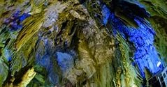](https://www.flickr.com/photos/tagiru/7566839800)

##### Abukuma Cave / 福島・あぶくま洞

[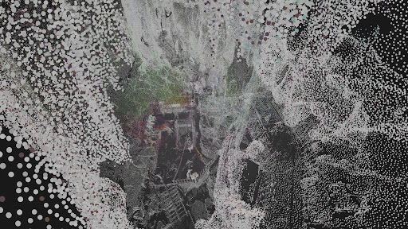Takine-Goten in Abukuma Cave, Fukushima, Japan - Download Free 3D model by yuichi hayakawa (@yshaya)あぶくま洞・滝根御殿の3D点群モデル 地上レーザ測量（TLS）により作成 http://geomorphoto.blogspot.jp/2014/05/stalactites-developed-in-abukuma-karst.html https://flic.kr/p/cwE2Rb 150214 point spacing 4 cm - Takine-Goten in Abukuma Cave, Fukushima, Japan - Download Free 3D model by yuichi hayakawa (@yshaya)](https://sketchfab.com/models/cc24c0e3e5614062a32872fec53df634?utm_source=oembed&utm_medium=embed&utm_campaign=cc24c0e3e5614062a32872fec53df634)

#### structure-from-motion / SfM多視点ステレオ写真測量

SfM多視点ステレオ写真測量（通称SfM）は、近年急速に地球科学分野で普及しつつある、高解像度地形情報の取得方法である。これは小型無人航空機（sUAV）やポールカメラ、手持ちカメラなどで大量の写真撮影を行い、対象の3次元情報を得るものである。この手法を用いた調査を多様な対象で行い、またTLSの計測結果とも合わせて、その解析・利活用について検討を進めている。

- Gomez, C., Hayakawa, Y.S., Obanawa, H. (2015) A study of Japanese landscapes using Structure from Motion derived DSMs and DEMs based on historical aerial photographs: New opportunities for vegetation monitoring and diachronic geomorphology. Geomorphology, in press. [doi:10.1016/j.geomorph.2015.02.021](http://dx.doi.org/10.1016/j.geomorph.2015.02.021)
- 小花和宏之・早川裕弌・加藤 顕・ゴメス クリストファー (2015) 小型無人航空機および単独測位GNSS搭載カメラを用いた簡易的な地形測量手法. 地形, 36 (2), in press.
[Obanawa, H., Hayakawa, Y.S., Kato, A., Gomez, C. (in press) Simplified mapping method using small UAV and GNSS equipped digital camera. Transactions, Japanese Geomorphological Union, in press.]
- 小花和宏之・早川裕弌・ゴメス クリストファー (2014) UAV空撮とSfMを用いたアクセス困難地の3Dモデリング. 地形, 35 (3), 283–294. [ [CiNii](http://ci.nii.ac.jp/naid/110009833192) ]
[Obanawa, H., Hayakawa, Y.S., Gomez, C. (2014) 3D modelling of inaccessible areas using UAV-based aerial photography and Structure from Motion. Transactions, Japanese Geomorphological Union, 35 (3), 283–294]
- 小花和宏之・早川裕弌・齋藤 仁・ゴメス クリストファー (2014) UAV-SfM手法と地上レーザ測量により得られたDSMの比較. 写真測量とリモートセンシング, 53 (2), 67–74. [ [CiNii](http://ci.nii.ac.jp/naid/40020108698) ]
[Obanawa, H., Hayakawa, Y.S., Saito, H., Gomez, C. (2014) Comparison of DSMs derived from UAV-SfM method and terrestrial laser scanning. Journal of the Japan Society of Photogrammetry and Remote Sensing, 53 (2), 67–74.]

[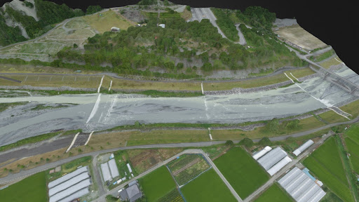onishiyama landslide foothill - 3D model by yuichi hayakawa (@yshaya)14.0813 - onishiyama landslide foothill - 3D model by yuichi hayakawa (@yshaya)](https://sketchfab.com/models/1016e7f475b34f27ae0d64dbed222bc6?utm_source=oembed&utm_medium=embed&utm_campaign=1016e7f475b34f27ae0d64dbed222bc6)

[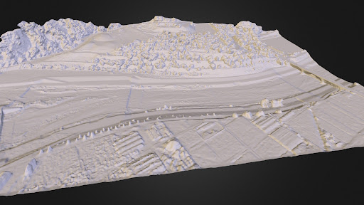onishiyama landslide foothill (untextured) - 3D model by yuichi hayakawa (@yshaya)14.0813 - onishiyama landslide foothill (untextured) - 3D model by yuichi hayakawa (@yshaya)](https://sketchfab.com/models/458f6ef68b364d7a90edf6b4a81129eb?utm_source=oembed&utm_medium=embed&utm_campaign=458f6ef68b364d7a90edf6b4a81129eb)

#### desktop laser scanning / 卓上レーザ計測

Hayakawa, Y., Oguchi, T. (2005) Evaluation of gravel sphericity and roundness based on surface-area measurement with a laser scanner. Computers & Geosciences, 31 (6), 735–741. [doi:10.1016/j.cageo.2005.01.004](http://dx.doi.org/10.1016/j.cageo.2005.01.004)

### geoarchaeology {#geoarchaeology}

#### geoarchaeology in west and central asia / 西アジア・中央アジアの地考古学

##### Syria / シリア

Hassake, Raqqa

##### Turkey / トルコ

[KAYAP - Kayseri Archaeology Project](http://kayap.exblog.jp/),

Kaman-Kalehöyük, Hacıtuğrul, Sabuniye

[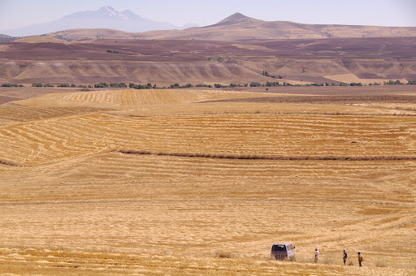Low-relief erosional surfaces and Erciyes Dağı (Mt. Erciyes) volcano in Anatolian highland / アナトリア高原の小起伏面とエルジエス火山（トルコ共和国カイセリ県）](https://www.flickr.com/photos/tagiru/14089779332)

[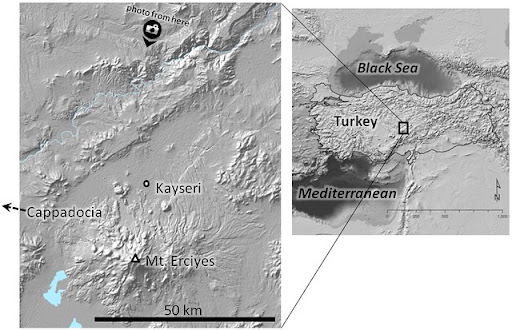Low-relief erosional surfaces and Erciyes Dağı (Mt. Erciyes) volcano in Anatolian highland / アナトリア高原の小起伏面とエルジエス火山（トルコ共和国カイセリ県）](https://www.flickr.com/photos/tagiru/13906318598)

##### Oman / オマーン

Jalan, Bat

##### Azerbaijan / アゼルバイジャン

Tovuz

##### Kyrgys / キルギス

Naryn, Issyk-Kul

[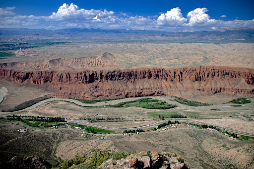The Naryn River and mountains in Naryn, northern Tien Shan (Kyrgiz) / キルギス共和国中部，ナリン高地](https://www.flickr.com/photos/tagiru/14582482534)

##### Kurdistan / クルディスタン（北イラク）

Sulaymaniyah

[Zagros Piedmont Prehistoric Project](https://zpp-project.blogspot.com/)

## grants {#grants}

競争的資金等の研究課題

### as principal investigator

- 04/2004-03/2007 Grant-In-Aid for JSPS Fellows, the Ministry of Education, Science, Sports and Culture of the Japanese Government (16-11373), “GIS analysis on formation and recession of knickzones and its impact on watershed landforms”, JPY 2,700,000
- 04/2007-03/2009 Grant-In-Aid for JSPS Fellows, the Ministry of Education, Science, Sports and Culture of the Japanese Government (19-2271), “Establishing a geomorphological model of bedrock rivers with effects of erosion of knickzones and mechanical properties of bedrock”, JPY 2,200,000
- 04/2010-03/2011 Fukada Grant-in-Aid of Fukada Geological Institute, “Changes in bedrock river morphology after earthquake : A case study of fault-scarp knickpoint erosion following Chi-Chi earthquake in west central Taiwan”, JPY 500,000
- 04/2011-03/2013 JSPS Grant-In-Aid for Young Scientists B (23701028), “Extraction of climate change signature from bedrock river longitudinal profiles”, JPY 4,420,000
- 04/2013-03/2018 JSPS Grant-In-Aid for Young Scientists A (25702014), “Establishment of protocols for morphological analysis of high-definition topography by terrestrial laser scanning and its core of excellence”, JPY 26,910,000
- 09/2013-03/2015 Grant-In-Aid for Academic Reserach of Japan Geographic Data Center, "Geoarchaeological mapping of late Holocene palaeoenvironment in central Anatolian highland, and its application for natural hazard risk assessment", JPY 1,000,000
- 04/2014-03/2017 JSPS Grant-In-Aid for Challenging Exploratory Research (26560153), "From past to future: Assessment of palaeodisasters and urban development risks in ancient and modern Turkey", JPY 3,770,000
- 04/2017-03/2021 JSPS Grant-In-Aid for Scientific Research B (17H02031), "Advanced use and optimization of high-density point cloud data in geomorphology: Detection of changes in watershed topographic environments and beyond", JPY 14,600,000
- 04/2017-03/2023 JSPS Fund for the Promotion of Joint International Research (Fostering Joint International Research) (16KK0012), "Developing geoscientific applications of high-definition topographic and ground feature information for the establishment of an international research network in Asia and Oceania", JPY 11,900,000
- 2018 JSPS Hirameki-Tokimeki Science (HT30063), JPY 490,000
- 2019 JSPS Hirameki-Tokimeki Science (19HT0004), JPY 490,000
- 2020 JSPS Hirameki-Tokimeki Science (20HT0001), JPY 500,000
- 2021 Hokkaido University Support System for the Joint Research of Next-Generation Researchers FY2021, JPY 500,000
- 10/2020-9/2021 Kurita Water and Environment Foundation (20E036), JPY 500,000
- 04/2021-03/2026 JSPS Grant-In-Aid for Scientific Research B (21H00625/23K20541), "[Study on connectivity of landform and vegetation systems in watersheds using Multidimensional High-definition Earth Surface Data](https://kaken.nii.ac.jp/en/grant/KAKENHI-PROJECT-23K20541/)", JPY 13,600,000
- 2021 JSPS Hirameki-Tokimeki Science (21HT0004), JPY 500,000
- 2021 Hokkaido University Support System for the Joint Research of Next-Generation Researchers FY2021, JPY 500,000
- 2023 JSPS Hirameki-Tokimeki Science (23HT0003), JPY 500,000
- 2023 Hokkaido University COI-NEXT fund for young researchers FY2023, JPY 500,000
- 2023-2024 JSPS Bilateral Joint Research Project with France (MEAE-MESRI SAKURA Program) "Medium- to long-term prediction of landslides and sediment connectivity using high-definition multi-temporal geospatial data", JPY2,000,000
- 2023-2025 Grant-in-Aid for JSPS Fellows 23KF0180 "[Multiscale topographic methods for landslide monitoring and prediction](https://kaken.nii.ac.jp/en/grant/KAKENHI-PROJECT-23KF0180)", JPY2,100,000
- 2024 JSPS Hirameki-Tokimeki Science (24HT0003), JPY 500,000
- 2024–2025 Subsidy for the Project to Establish Research Centers for the Social Implementation of Artificial Intelligence, etc., Developing a Research Data Ecosystem for the Promotion of Data-Driven Science; Use Case Creation Project: “Establishment of a 3D Data Utilization Infrastructure in Earth-Human System Science”, JPY 5,000,000
- 2025 JSPS Hirameki-Tokimeki Science (25HT0002), JPY 500,000
- 2025–2026 Hokkaido University IRAFF/J-PEAKS "Establishing regenerative tourism with digital twin of natural parks and 3D technology", JPY 3,000,000
- 2026 JSPS Hirameki-Tokimeki Science (26HT0001), JPY 500,000
- 2026–2027 Tokyo Geographical Society, "Development and utilization of a digital twin of mountain environment using high-definition 3D geospatial data", JPY 2,000,000
- 2026–J2027 apan Science and Technology Agency (JST), LOTUS Programme (289041), "Integrating Multi-Sensor Satellite Data and Deep Learning for the Spatio-Temporal Projection of Surface Deformation Due to Over-Extraction of Groundwater and Rapid Urban Expansion Across Metropolitan", JPY 4,452,000

### 代表者

- 2004年4月-2007年3月 日本学術振興会・科学研究費補助金（特別研究員奨励費）「[遷急区間の形成と後退にともなう流域の地形変化に関する地理情報科学的研究](https://kaken.nii.ac.jp/d/p/04J11373.ja.html)」
- 2007年4月-2009年3月 日本学術振興会・科学研究費補助金（特別研究員奨励費）「遷急区間侵食と基盤岩石物性を組み入れた岩盤河川の地形発達モデルの構築」
- 2010年4月-2011年3月 深田地質研究助成「地震発生後の岩盤河川地形変化の解明：台湾中西部，集集地震に起因する遷急点侵食の事例」
- 2011年4月-2013年3月 日本学術振興会・科学研究費補助金・若手研究（B）(23701028)「[岩盤河川縦断面形における気候変化の痕跡の抽出](https://kaken.nii.ac.jp/ja/grant/KAKENHI-PROJECT-23701028/)」
- 2013年4月-2018年3月 日本学術振興会・科学研究費補助金・若手研究（A）(25702014)「[地上レーザスキャンによる高精細地形解析プロトコルの確立と研究拠点の形成](https://kaken.nii.ac.jp/d/p/25702014.ja.html)」
- 2013年9月-2015年3月 国土地理協会学術研究助成「アナトリア高原中部における後期完新世の考古環境マッピングー大規模災害リスク評価に向けてー」
- 2014年4月-2017年3月 日本学術振興会・科学研究費補助金・挑戦的萌芽研究 (26560153)「[過去から未来へ－古代トルコにおける自然災害の痕跡と現代の都市開発リスクの評価](https://kaken.nii.ac.jp/ja/grant/KAKENHI-PROJECT-26560153/)」
- 2017年4月-2021年3月 日本学術振興会・科学研究費補助金・基盤研究（B）(17H02031)「[高密度点群情報の地形学的な高度利用と最適化：流域地形環境変動の抽出からその先へ](https://kaken.nii.ac.jp/ja/grant/KAKENHI-PROJECT-17H02031/)」
- 2017年4月-2023年3月 日本学術振興会・科学研究費助成事業・国際共同研究加速基金（国際共同研究強化）（16KK0012）「[アジアオセアニア域の研究拠点形成に向けた高精細地形地物情報の地球科学的応用の展開](https://kaken.nii.ac.jp/ja/grant/KAKENHI-PROJECT-16KK0012/)」
- 2018年度 日本学術振興会・研究成果の社会還元・普及事業・ひらめき☆ときめきサイエンス～ようこそ大学の研究室へ～KAKENHI（HT30063）「ダンボールで島と滝をつみあげよう！〜さわってわかる高精細 3D情報〜」
- 2019年度 日本学術振興会・科学研究費助成事業・科学研究費補助金・研究成果公開促進費（研究成果公開発表（Ｂ）ひらめき☆ときめきサイエンス～ようこそ大学の研究室へ～ＫＡＫＥＮＨＩ（19HT0004）「ダンボールで島と滝をつみあげよう！〜さわってわかる高精細3D情報〜」
- 2020年度 日本学術振興会・科学研究費助成事業・科学研究費補助金・研究成果公開促進費・研究成果公開発表（Ｂ）ひらめき☆ときめきサイエンス～ようこそ大学の研究室へ～ＫＡＫＥＮＨＩ（20HT0001）「ダンボールで島と滝をつみあげよう！－さわってわかる高精細3D情報－」
- 2020年度 北海道大学・次世代研究者リーダー育成共同研究助成「大規模斜面崩壊の発生後における3次元的流域環境変動の評価」
- 2020年10月-2021年9月 公益財団法人クリタ水・環境科学振興財団・国内研究助成（20E036）「水環境のなかで消えゆく文化景観の3次元保存と可視化」
- 2021年4月-2026年3月 日本学術振興会・科学研究費補助金・基盤研究（B）(21H00625/23K20541)「[多次元高精細地表情報を用いた流域内地形-植生系のconnectivityの研究](https://kaken.nii.ac.jp/ja/grant/KAKENHI-PROJECT-23K20541/)」
- 2021年度 日本学術振興会・科学研究費助成事業・科学研究費補助金・研究成果公開促進費・研究成果公開発表（Ｂ）ひらめき☆ときめきサイエンス～ようこそ大学の研究室へ～ＫＡＫＥＮＨＩ（21HT0004）「ダンボールで島と滝をつみあげよう！－さわってわかる高精細3D情報－」
- 2021年度 北海道大学・次世代研究者リーダー育成共同研究助成「大規模斜面崩壊の発生後における流域環境変動の多次元的評価」
- 2023年度 日本学術振興会・科学研究費助成事業・科学研究費補助金・研究成果公開促進費・研究成果公開発表（Ｂ）ひらめき☆ときめきサイエンス～ようこそ大学の研究室へ～ＫＡＫＥＮＨＩ（23HT0003）「ドローンでミニチュア地形をつくろう！－みて、さわって、多次元高精細地表情報－」
- 2023年度 北海道大学・共創の場形成支援プログラム（COI－NEXT）「こころとカラダのライフデザイン共創拠点」若手研究ファンド「デジタル空間データを用いた都市近郊山地における野外活動がもたらす心体の健康と安全の最適化」
- 2023-2024年度 日本学術振興会・二国間交流事業共同研究・フランス（MEAE-MESRI・SAKURAプログラム）（120233201）「高精細時空間情報を用いたランドスライドと土砂コネクティビティの中長期予測」
- 2023-2025年度 日本学術振興会・科学研究費助成事業・科学研究費補助金・特別研究員奨励費（23KF0180）「[地すべり・斜面崩壊のモニタリングと予測のための多重スケール地形計量手法の開発](https://kaken.nii.ac.jp/ja/grant/KAKENHI-PROJECT-23KF0180)」
- 2024年度 日本学術振興会・科学研究費助成事業・科学研究費補助金・研究成果公開促進費・研究成果公開発表（Ｂ）ひらめき☆ときめきサイエンス～ようこそ大学の研究室へ～ＫＡＫＥＮＨＩ（24HT0003）「ドローンでミニチュア地形をつくろう！－みて、さわって、想像する地形景観－」
- 2024–2025年度 人工知能等社会実装研究拠点事業費補助金・ＡＩ等の活用を推進する研究データエコシステム構築事業ユースケース創出事業（2024-12）「地球人間圏科学における3Dデータ活用基盤の構築」
- 2025年度 日本学術振興会・科学研究費助成事業・科学研究費補助金・研究成果公開促進費・研究成果公開発表（Ｂ）ひらめき☆ときめきサイエンス～ようこそ大学の研究室へ～ＫＡＫＥＮＨＩ（25HT0002）「ドローンでミニチュア地形をつくろう！－みて、さわって、想像する地形景観－」
- 2025–2026年度 北海道大学リジェネラティブ農林水産研究拠点（IRAFF/J-PEAKS）・未来創造リジェネラティブ研究支援事業「自然公園デジタルツインの構築と3D活用によるリジェネラティブ観光」
- 2026年度 日本学術振興会・科学研究費助成事業・科学研究費補助金・研究成果公開促進費・研究成果公開発表（Ｂ）ひらめき☆ときめきサイエンス～ようこそ大学の研究室へ～ＫＡＫＥＮＨＩ（26HT0001）「ドローンでミニチュア地形をつくろう！－みて、さわって、想像する地形景観－」
- 2026–2027年度 東京地学協会・令和8年度調査・研究助成金「高精細三次元地理情報を活用した登山環境デジタルツインの構築と活用」
- 2026–2027年度 科学技術振興機構・インド若手科学頭脳循環プログラム（LOTUS1年型）（289041）「大都市圏周辺域における地下水の過剰採取と急速な都市拡大に起因する地表変形の時空間的予測に向けたマルチセンサ衛星データと深層学習の統合」

### as co-investigator

### 研究分担者

- 2013年4月-2017年3月 日本学術振興会・科学研究費補助金・基盤研究（B）海外学術（25300040）「[ユーラシア古代遊牧社会形成の比較考古学](https://nrid.nii.ac.jp/ja/external/1000070549443/?lid=KAKENHI-PROJECT-25300040&mode=kaken-d)」（代表：国士舘大学・大沼克彦）
- 2014年4月-2017年3月 日本学術振興会・科学研究費補助金・挑戦的萌芽研究（26560154）「[地誌的視点を取り入れた旅行ガイドブックとその一般普及に関する基礎研究](https://kaken.nii.ac.jp/ja/grant/KAKENHI-PROJECT-26560154/)」（代表：お茶の水女子大学・長谷川直子）
- 2014年4月-2017年3月 日本学術振興会・科学研究費補助金・基盤研究（C）（26350399）「[塩類風化に伴う岩屑の生産速度と岩盤壁面の形状変化](https://kaken.nii.ac.jp/ja/grant/KAKENHI-PROJECT-26350399/)」（代表：埼玉大学・小口千明）
- 2014年4月-2017年3月 日本学術振興会・科学研究費補助金・基盤研究（B）（26292077）「[流域土砂貯留量の変化に着目した深層崩壊の評価手法の開発](https://nrid.nii.ac.jp/ja/nrid/1000070549443/)」（代表：筑波大学・堀田紀文）
- 2016年4月-2021年3月 日本学術振興会・科学研究費補助金・基盤研究（A）海外学術（16H02712）「[ダストフラックス長期変動に寄与する人為的影響の定量的評価](https://nrid.nii.ac.jp/ja/external/1000070549443/?lid=KAKENHI-PROJECT-16H02712&mode=kaken-d)」（代表：九州大学・鹿島 薫）
- 2017年4月-2021年3月 日本学術振興会・科学研究費補助金・基盤研究（B）海外学術（17H04533）「[中央ユーラシア高地民・低地民の相互交流と騎馬遊牧社会の成立基盤に関する考古学研究](https://kaken.nii.ac.jp/ja/grant/KAKENHI-PROJECT-17H04533/)」（代表：東京藝術大学・久米正吾）
- 2018年4月-2022年3月 日本学術振興会・科学研究費補助金・基盤研究（A）（18H03957）「[分布型水土流出モデルの長期解析に基づく流木被害軽減のための森林管理手法の検討](https://kaken.nii.ac.jp/ja/grant/KAKENHI-PROJECT-18H03957/)」（代表：東京大学・堀田紀文）
- 2018年4月-2023年3月 日本学術振興会・科学研究費補助金・基盤研究（B）（18H02235）「[発生場の将来予測による中長期的な土石流リスク評価手法の開発](https://nrid.nii.ac.jp/ja/external/1000070549443/?lid=KAKENHI-PROJECT-18H02235&mode=kaken-d)」（代表：静岡大学・今泉文寿）
- 2019年4月-2022年3月 日本学術振興会・科学研究費補助金・基盤研究（C）（19K01156）「[湿潤変動帯における大規模崩壊地の土砂生産プロセスの解明](https://kaken.nii.ac.jp/ja/grant/KAKENHI-PROJECT-19K01156/)」（代表：新潟大学・西井稜子）
- 2019年10月-2020年3月 文化庁・受託研究・文化遺産保護国際貢献事業（専門家交流）「[ウズベキスタン共和国等中央アジア諸国における文化遺産保護国際貢献事業](https://www.eurasia-geidai.org/centralasia)（専門家交流）」（代表：東京藝術大学・久米正吾）
- 2021年4月-2024年3月 日本学術振興会・科学研究費補助金・基盤研究（B）（21H00627）「[地理情報科学のオンライン実習教材を用いた自然地理・防災教育の展開と効果の分析](https://kaken.nii.ac.jp/ja/grant/KAKENHI-PROJECT-21H00627/)」（代表：東京大学・小口 高）
- 2021年4月-2025年3月 日本学術振興会・科学研究費補助金・基盤研究（B）（21H00590/23K20514）「[メソポタミア先史農耕社会にみる都市文明の起源](https://kaken.nii.ac.jp/ja/grant/KAKENHI-PROJECT-21H00590/)」（代表：筑波大学・前田 修）
- 2021年4月-2026年3月 日本学術振興会・科学研究費補助金・基盤研究（A）（21H04357）「[原シルクロードの形成－中央アジア山岳地帯の初期開発史に関する総合研究－](https://kaken.nii.ac.jp/ja/grant/KAKENHI-PROJECT-21H04357/)」（代表：金沢大学・久米正吾）
- 2021年10月-2027年3月 日本学術振興会・科学研究費助成事業・国際共同研究加速基金（国際共同研究強化（B））（21KK0012）「[ルーマニアの土砂移動と土砂災害の自然的要因と社会との関係の研究](https://kaken.nii.ac.jp/ja/grant/KAKENHI-PROJECT-21KK0012/)」（代表：東京大学・小口 高）
- 2022年4月-2025年3月 日本学術振興会・科学研究費補助金・基盤研究（B）（22H02374/23K23639）「[森林内を飛行するドローンレーザーによる空隙分布の高精度評価](https://kaken.nii.ac.jp/ja/grant/KAKENHI-PROJECT-22H02374/)」（代表：千葉大学・加藤 顕）
- 2022年4月-2025年3月 日本学術振興会・科学研究費補助金・基盤研究（B）（22H03787/23K25041）「[見えない自然を守る～DNAによる河川地下フロンティア領域の可視化](https://kaken.nii.ac.jp/ja/grant/KAKENHI-PROJECT-22H03787/)」（代表：北海道大学・根岸淳二郎）
- 2022年4月-2025年3月 日本学術振興会・科学研究費補助金・基盤研究（B）（22H00754/23K22026）「[プレート境界における歪蓄積過程と地表地震断層の関係 －台湾台東縦谷断層を対象にー](https://kaken.nii.ac.jp/ja/grant/KAKENHI-PROJECT-22H00754/)」（代表：岡山大学・松多信尚）
- 2023年4月-2026年3月 日本学術振興会・科学研究費補助金・基盤研究（B）（23H00692/23K25389）「[「肥沃な三日月地帯」東翼における新石器化から都市化への移行過程](https://kaken.nii.ac.jp/ja/grant/KAKENHI-PROJECT-23H00692/)」（代表：金沢大学・小高 敬寛）
- 2023年4月-2027年3月 日本学術振興会・科学研究費補助金・基盤研究（B）（23H02250/23K26943）「[地形モニタリング手法とシミュレータの開発による土石流予測の高精度化](https://kaken.nii.ac.jp/ja/grant/KAKENHI-PROJECT-23H02250/)」（代表：静岡大学・今泉文寿）
- 2023年4月-2027年3月 日本学術振興会・科学研究費補助金・基盤研究（B）（23H00725/23K25422）「[高精細地表情報を用いた植生景観の定量的把握と土砂災害脆弱性の評価](https://kaken.nii.ac.jp/ja/grant/KAKENHI-PROJECT-23H00725/)」（代表：名古屋大学・齋藤 仁）
- 2025年4月－2030年3月 日本学術振興会・科学研究費補助金・基盤研究（B）（25K01470）「[高精細多層地表情報計測を活用した革新的な地すべり調査法の確立](https://kaken.nii.ac.jp/ja/grant/KAKENHI-PROJECT-25K01470/)」（代表：北海道大学・笠井美青）
- 2025年4月－2031年3月 国土交通省・河川砂防技術研究開発（1303447）「[河川のジオ多様性が駆動する生息場の時空間変動と生物多様性—自然再興実現に向けた生態系管理処方箋—](https://research-er.jp/projects/view/1303447)」（代表：北海道大学・根岸淳二郎）
- 2025年12月－2029年3月 日本学術振興会・スイスとの国際共同研究プログラム「気候変動が山岳域の土砂動態へ与える影響の総合理解―スイス・日本の比較研究―」（代表：静岡大学・今泉文寿）
- 2026年4月－2030年3月 日本学術振興会・科学研究費補助金・基盤研究（B）（26K03145）「[脱炭素化困難分野における残余排出の定量化とその削減方策の評価](https://kaken.nii.ac.jp/en/grant/KAKENHI-PROJECT-26K03145/)」（代表：北海道大学・大城 賢）
- 2026年6月－2027年3月 三島海雲記念財団・学術研究奨励金・人文科学部門「[中央アジアにおける拝火儀礼の起源と展開に関する実証的研究](https://www.mishima-kaiun.or.jp/works/works-2427/)」（代表：金沢大学・久米正吾）

## reviews {#reviews}

review and editorial history for journal articles and book chapters

学術誌・専門書籍の査読・編集履歴

### journals served as reviewer

(2006 – 2020.02.22) Geomorphology (50), Remote Sensing (15), Environmental Earth Sciences (9), Sustainability (8), Sensors (8), Engineering Geology (7), Journal of the Japan Landslides Society (地すべり学会誌) (7), ISPRS International Journal of Geo-Information (7), Carbonates and Evaporites (7), E-journal GEO (6), Transactions, Japanese Geomorphological Union (地形) (6), Frontiers in Environmental Science (5), Earth Surface Processes and Landforms (5), Natural Hazards and Earth System Sciences (4), Frontiers in Earth Science (4), Forests (2), Hydrology (2), Journal of Imaging (2), Earth Surface Dynamics (2), Geofluids (3), International Journal of Remote Sensing (2), Journal of Geophysical Research: Earth Surface (2), Catena (2), Journal of Agricultural Meteorology (2), Scientific Reports (2), Landslides (2), Japanese Journal of Forest Planning (森林計画学会誌) (2), Quaestiones Geographicae (2),Computer-Aided Design (1), Journal of Sedimentary Research (1), International Journal of Earth Sciences (1), International Journal of Environmental Research and Public Health (1), Landscape and Ecological Engineering (1), Geochemical Journal (1), GFF (1), Journal of the Geological Society of India (1), Journal of Mountain Science (1), Arabian Journal of Geosciences (1), Chirigaku Hyoron/Geographical Review of Japan (地理学評論) (1), Journal of Scientific Research and Reports (1), Water (1), Applied Water Science (1), Theory and Applications of GIS (GIS理論と応用) (1), World Landslide Forum (1), Interface Focus (1), Journal of Culture and Information Science (文化情報学) (1), International Journal of Digital Earth (1), Science of the Total Environment (1), Open Geosciences (1), Earth-Science Reviews (1)

### journals served as editor

Progress in Earth and Planetary Science (4), Natural Hazards and Earth System Sciences (4), E-journal GEO (1), Geomorphology (5)
