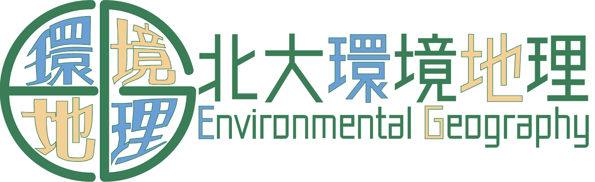

# members

## 現メンバー

研究室「[環境地理](https://envgeo.ees.hokudai.ac.jp/members/)」のページをご覧ください。

## ポスドク、大学院生募集中

### 大学院受験をお考えの方へ

入試について詳しくはこちらをご覧ください→ [環境起学専攻入試](https://www.ees.hokudai.ac.jp/division/kigaku/modules/admission/nyusi.html?easiestml_lang=ja)

※環境科学院 環境起学専攻 [人間・生態システムコース](http://www.ees.hokudai.ac.jp/division/kigaku/modules/courses/HES.html?easiestml_lang=ja/)または[国際環境保全コース（英語）](https://www.ees.hokudai.ac.jp/division/kigaku/modules/courses/GEM.html)となります

本研究室へのお問い合わせは[こちらのeメールアドレス](/)へお願いします。

（参考）[tayoコミュニティページ](https://tayo.jp/communities/01JNATTC8YWH000A8CXX4P5H4E)
