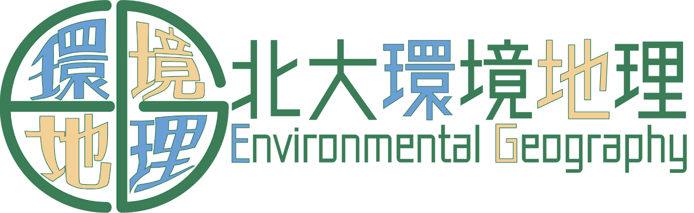

# members

## current Members

研究室「[環境地理](https://envgeo.ees.hokudai.ac.jp/members/)」のページをご覧ください。

Please refer to the page of our laboratory, "[Environmental Geography](https://envgeo.ees.hokudai.ac.jp/members/)".

## ポスドク、大学院生募集中

### 大学院受験をお考えの方へ

入試について詳しくはこちらをご覧ください→ [環境起学専攻入試](https://www.ees.hokudai.ac.jp/division/kigaku/modules/admission/nyusi.html?easiestml_lang=ja)

※環境科学院 環境起学専攻 [人間・生態システムコース](http://www.ees.hokudai.ac.jp/division/kigaku/modules/courses/HES.html?easiestml_lang=ja/)または[国際環境保全コース（英語）](https://www.ees.hokudai.ac.jp/division/kigaku/modules/courses/GEM.html)となります

本研究室へのお問い合わせは[こちらのeメールアドレス](/)へお願いします。

（参考）[tayoコミュニティページ](https://tayo.jp/communities/01JNATTC8YWH000A8CXX4P5H4E)

## post-docs or graduate students

### For prospective graduate students

Please have a careful look at [this page](https://www.ees.hokudai.ac.jp/division/kigaku/modules/admission/nyusi.html?easiestml_lang=en) for details of the entrance examination (also, [here](https://www.ees.hokudai.ac.jp/division/kigaku/modules/admission/mondai.html?easiestml_lang=en) are samples on past entrance examinations).

# select [Course in Human and Ecological Systems](https://www.ees.hokudai.ac.jp/division/kigaku/modules/courses/HES.html?easiestml_lang=en) or [Course in Global Environmental Management](https://www.ees.hokudai.ac.jp/division/kigaku/modules/courses/GEM.html?easiestml_lang=en)

# please refer to [this page](https://www.global.hokudai.ac.jp/admissions/scholarships/scholarships-for-prospective-students/) for scholarships

Please ask by [emails](/contact/) for further queries.

Google サイト

不正使用を報告
