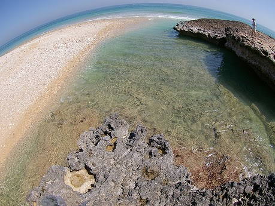
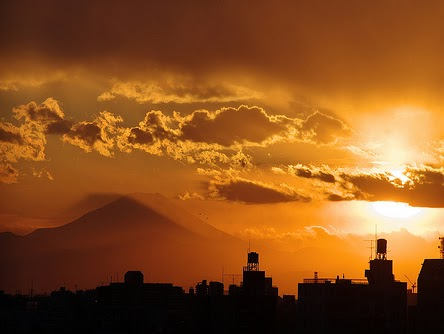
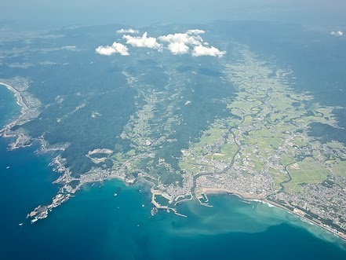
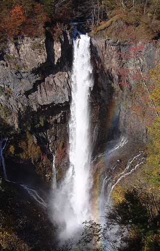

## albums

## archive

### 2010

[Japanese Geomorphological Union 2010 Joint Meeting in Ankara, Turkey - September 2010](http://www.csis.u-tokyo.ac.jp/~hayakawa/photo/2010-09-12-17_JGU_Ankara/)

### 2010

[during archaeological survey in Raqqa - March 2010](https://goo.gl/photos/7uk4kUBkkh2rXchQ6)

### 2009

[International Conference on Geomorphology in Melbourne, Australia - July 2009](http://www.csis.u-tokyo.ac.jp/~hayakawa/photo/ICG_Melbourne_2009/)

### 2008

[geoarchaeological survey along the eastern coast in Oman - March 2008](http://www.csis.u-tokyo.ac.jp/~hayakawa/photo/oman_2008/)

Google サイト

不正使用を報告
